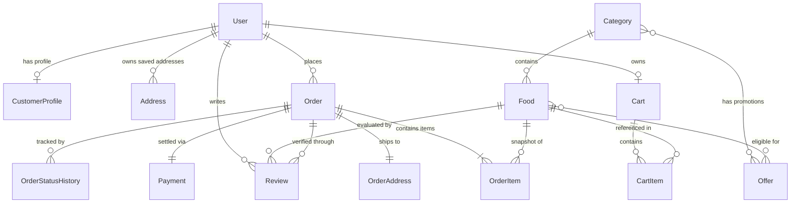

# 🥢 Mahato Chinese Fast Food — Project Documentation

A full-stack, responsive online food ordering and restaurant management web application built with **Django 6**, **SQLite**, **Bootstrap 5**, and **Docker**.

This project provides an end-to-end e-commerce experience tailored for a Chinese restaurant, featuring customer authentication, categorized menu exploration with dietary and spice filters, real-time cart calculations, checkout with delivery address selection, order status tracking, and verified customer reviews.

---

## 📋 Table of Contents

1. [Project Overview](#-project-overview)
2. [Technology Stack](#-technology-stack)
3. [Architecture & Workflow](#-architecture--workflow)
4. [Application Modules Breakdown](#-application-modules-breakdown)
   - [1. Accounts App](#1-accounts-app)
   - [2. Menu App](#2-menu-app)
   - [3. Cart App](#3-cart-app)
   - [4. Orders App](#4-orders-app)
   - [5. Home App](#5-home-app)
   - [6. MahatoChineseCenter (Core)](#6-mahatochinesecenter-core)
5. [Database Models & Entity Relationships](#-database-models--entity-relationships)
6. [Complete User Journey](#-complete-user-journey)
7. [Directory Structure](#-directory-structure)
8. [URL & Route Reference](#-url--route-reference)
9. [How to Run the Project](#-how-to-run-the-project)
10. [Docker Deployment](#-docker-deployment)
11. [Admin Management](#-admin-management)

---

## 🌟 Project Overview

**Mahato Chinese Fast Food** is engineered to simulate a modern food delivery platform (similar to Zomato or Swiggy) focused on Chinese cuisine:
* **Rich Catalog**: Categorized dishes (Momos, Fried Rice, Noodles, etc.) with badges for vegetarian/non-vegetarian, spice level, calories, preparation time, and discounts.
* **Smart Shopping Cart**: Automatically calculates subtotal, discounts, 5% GST tax, and free delivery thresholds (free above ₹300).
* **Robust Checkout**: Supports existing address books, inline new address creation, Cash on Delivery (COD), and mock online payments.
* **Live Order Progression**: Step-by-step order lifecycle tracking (`Placed` ➔ `Confirmed` ➔ `Preparing` ➔ `Ready` ➔ `Out for Delivery` ➔ `Delivered`).
* **Verified Customer Feedback**: Only customers who ordered and received a dish can leave star ratings and reviews.
* **Context Processors**: Global navbar cart counter updated automatically across all pages.

---

## 🛠 Technology Stack

| Layer | Technology | Details |
|---|---|---|
| **Backend Framework** | Django 6.1 | Python 3.13 web framework (MVT architecture) |
| **Database** | SQLite 3 | Relational database (`db.sqlite3`), production-ready for PostgreSQL via psycopg3 |
| **Frontend UI** | HTML5, CSS3, Bootstrap 5.3 | Responsive mobile-first layout with custom CSS variables |
| **Typography & Icons** | FontAwesome 6, Google Fonts | Inter (body) & Outfit (headings) |
| **Image Processing** | Pillow (12.3.0) | Handles food and category image uploads |
| **Containerization** | Docker & Gunicorn | Production container setup |

---

## 🔄 Architecture & Workflow

The project follows Django's standard **Model-View-Template (MVT)** design pattern:

```
[ Browser / Client ]
        │
        ▼  HTTP Request
[ MahatoChineseCenter/urls.py ] ──► URL Dispatcher
        │
        ▼  Routes to specific App Views
[ accounts | menu | cart | orders | home ]
        │
        ├──► Query Database [ models.py (SQLite) ]
        ├──► Execute Business Logic (Totals, Taxes, Validations)
        └──► Render UI Template [ templates/*.html ]
        │
        ▼  HTTP Response (HTML + CSS + Static Media)
[ Client Browser Render ]
```

---

## 📦 Application Modules Breakdown

### 1. Accounts App (`accounts/`)
Manages user onboarding, profile details, and shipping addresses.
* **User Authentication (`views.py`)**:
  * `login_view`: Supports authentication by either **username** or **email** address.
  * `signup_view`: Validates unique usernames and emails, verifies password match, creates a Django `User`, and initializes a linked `CustomerProfile`.
  * `logout_view`: Clears session and redirects to homepage.
* **Profile & Address Book**:
  * `profile_view`: Displays user profile information, recent orders, and saved addresses.
  * `add_address`: Adds a structured shipping address (full name, phone, address lines, landmark, city, state, pincode, type: `HOME`/`OFFICE`/`OTHER`, and `is_default` flag).
  * `set_default_address`: Dynamically toggles which address is pre-selected at checkout.
  * `delete_address`: Removes obsolete addresses.

### 2. Menu App (`menu/`)
Handles the food catalog, categories, search, filtering, and verified reviews.
* **Models**:
  * `Category`: Title, slug, description, image, and active status.
  * `Food`: Categorized item with price, discount percentage, calories, spice level (`MILD`, `MEDIUM`, `HOT`, `EXTRA_HOT`), food type (`VEG`, `NON_VEG`), preparation time, and image. Computes `final_price` via property methods.
  * `Offer`: Promotional coupons or percentage/flat discounts linked to foods or categories.
  * `Review`: Customer rating (1 to 5 stars) and comments. Uses a `UniqueConstraint` on `(user, food, order)` to prevent duplicate reviews for the same order item.
* **Views**:
  * `menu_view`: Features multi-criteria filtering:
    * Text search (`?q=`) across food name and description.
    * Category slug filtering (`?category=`).
    * Dietary preference filtering (`?type=VEG|NON_VEG`).
    * Heat/spice level filtering (`?spice=MILD|MEDIUM|HOT|EXTRA_HOT`).
  * `food_detail_view`: Shows item specs, computed average rating, approved reviews, and an active review form **only for users with confirmed delivered orders**.

### 3. Cart App (`cart/`)
Provides real-time shopping cart management and state persistence.
* **Models**:
  * `Cart`: Linked 1-to-1 with an authenticated `User`.
  * `CartItem`: Links `Cart` to `Food` with quantity validation (`quantity >= 1`).
* **Views**:
  * `cart_view`: Calculates subtotal, 5% GST tax, delivery fee (₹40 if order < ₹300, free if ≥ ₹300), and final grand total.
  * `add_to_cart`: Increments item quantity if present or creates a new entry.
  * `update_cart`: Handles `increase` or `decrease` actions. Decrementing below 1 automatically removes the item.
  * `remove_from_cart`: Immediately deletes the item from the cart.
* **Context Processor (`cart/context_processors.py`)**:
  * `cart_renderer`: Injected into Django's template engine; supplies `{{ cart_count }}` globally so the navigation bar badge updates on every page.

### 4. Orders App (`orders/`)
Coordinates checkout, payment options, immutable snapshots, and order tracking.
* **Models**:
  * `Order`: Stores unique order number (`MC-YYYYMMDD-XXXXX`), status, subtotal, discount, delivery fee, tax, total amount, and special instructions.
  * `OrderAddress`: A historical snapshot of the delivery address at the moment of order placement.
  * `OrderItem`: An immutable snapshot of the food item, quantity, unit price, and discount at purchase time.
  * `Payment`: Tracks payment method (`COD` or `MOCK_ONLINE`), status (`PENDING`, `SUCCESS`, `FAILED`), and generated transaction ID.
  * `OrderStatusHistory`: Audit log capturing every status transition, timestamp, and optional status notes.
* **Views**:
  * `checkout_view`:
    * Wrapped in **`transaction.atomic()`** to ensure ACID compliance: creates `Order`, copies address into `OrderAddress`, snapshots all `OrderItem` rows, records `Payment`, initializes `OrderStatusHistory`, and purges the shopping cart atomically.
  * `order_success_view`: Displays confirmation receipt and estimated delivery notification.
  * `order_history_view`: Chronological list of user's past orders with status badges.
  * `order_detail_view`: Visual tracker showing the order progression bar through all fulfillment stages.

### 5. Home App (`home/`)
* **`home_view`**: The landing storefront featuring:
  * Active promotional banners and coupon offers.
  * Top food categories carousel.
  * Featured dishes and chef's special recommendations.

### 6. MahatoChineseCenter (Core Configuration)
* **`settings.py`**: Configuration for installed apps, middleware, template directory, SQLite database, static/media file routing, and console email backend.
* **`urls.py`**: Central URL router linking all sub-apps.
* **`views.py`**: Exposes a `/health` endpoint returning JSON status of service health and database connectivity.

---

## 🗄 Database Models & Entity Relationships



---

## 🚶 Complete User Journey

1. **Discovery & Exploration**:
   - The user visits the homepage `http://127.0.0.1:8000/` and explores featured items and active discounts.
   - Visits `/menu/` to browse categories, filter by **Veg** or **Spice Level**, or search for specific dishes like *"Schezwan Noodles"*.
2. **Item Inspection**:
   - The user opens `/menu/<slug>/` to view calories, preparation time, and customer feedback.
3. **Cart Operations**:
   - The user clicks **Add to Cart**.
   - The navbar updates the cart badge count via the context processor.
   - On `/cart/`, quantities are adjusted; taxes and shipping fees are calculated in real time.
4. **Checkout**:
   - The user navigates to `/orders/checkout/`.
   - Selects a default address or enters a new one.
   - Chooses a payment mode: **Cash on Delivery (COD)** or **Mock Online Payment**.
   - The database creates an atomic order record, logs payment details, and empties the cart.
5. **Fulfillment Tracking**:
   - The user monitors order milestones on `/orders/<order_number>/` (`Placed` ➔ `Confirmed` ➔ `Preparing` ➔ `Ready` ➔ `Out for Delivery` ➔ `Delivered`).
6. **Reviewing**:
   - Once marked `DELIVERED` by the admin, the user returns to the food detail page and submits a rating and review.

---

## 📂 Directory Structure

```text
F:\Mahato_chinese_FastFood\
├── accounts/                     # User profiles, auth, and address management
│   ├── migrations/               # Database migration files
│   ├── models.py                 # CustomerProfile & Address models
│   ├── urls.py                   # /accounts/ routes
│   └── views.py                  # Login, signup, profile, and address views
├── cart/                         # Cart management
│   ├── context_processors.py     # cart_renderer for global item counter
│   ├── models.py                 # Cart & CartItem models
│   ├── urls.py                   # /cart/ routes
│   └── views.py                  # Add, update, and remove cart views
├── home/                         # Landing page & promotions
│   ├── urls.py                   # / route
│   └── views.py                  # home_view
├── MahatoChineseCenter/          # Project root configuration
│   ├── asgi.py                   # ASGI entry point
│   ├── settings.py               # Django global settings
│   ├── urls.py                   # Master URL dispatcher
│   ├── views.py                  # Health check view (/health)
│   └── wsgi.py                   # WSGI entry point
├── media/                        # User-uploaded files (food & category images)
│   ├── categories/               # Uploaded category thumbnails
│   └── foods/                    # Uploaded dish pictures
├── menu/                         # Menu, food items, offers, and reviews
│   ├── models.py                 # Category, Food, Offer, Review models
│   ├── urls.py                   # /menu/ routes
│   └── views.py                  # Menu search/filter & food detail views
├── orders/                       # Checkout, orders, payments, and history
│   ├── models.py                 # Order, OrderAddress, OrderItem, Payment
│   ├── urls.py                   # /orders/ routes
│   └── views.py                  # Checkout, order tracking, and history views
├── static/                       # Custom CSS, JS, and brand icons
├── templates/                    # HTML Templates (Bootstrap 5)
│   ├── base.html                 # Master layout template (navbar & footer)
│   ├── accounts/                 # login.html, signup.html, profile.html, etc.
│   ├── cart/                     # cart.html
│   ├── home/                     # index.html
│   ├── menu/                     # menu.html, food_detail.html
│   └── orders/                   # checkout.html, order_detail.html, etc.
├── venv/                         # Python 3.13 virtual environment
├── db.sqlite3                    # SQLite database containing seeded records
├── Dockerfile                    # Container configuration with Gunicorn
├── manage.py                     # Django management script
├── README.md                     # Comprehensive project documentation
└── requirements.txt              # Project dependencies
```

---

## 🌐 URL & Route Reference

| URL Path | App | View Name | Purpose |
|---|---|---|---|
| `/` | `home` | `home` | Storefront landing page |
| `/health` | `core` | `health_check` | JSON API endpoint checking DB & service uptime |
| `/admin/` | `django.contrib.admin` | `admin:index` | Django administrative dashboard |
| `/menu/` | `menu` | `menu` | Browse menu with search, category & spice filters |
| `/menu/<slug>/` | `menu` | `food_detail` | Food detail page & review submission |
| `/cart/` | `cart` | `cart` | Shopping cart overview |
| `/cart/add/<food_id>/` | `cart` | `add_to_cart` | Add item to cart |
| `/cart/update/<item_id>/` | `cart` | `update_cart` | Increment / decrement item quantity |
| `/cart/remove/<item_id>/` | `cart` | `remove_from_cart` | Delete item from cart |
| `/accounts/login/` | `accounts` | `login` | Customer login (username or email) |
| `/accounts/signup/` | `accounts` | `signup` | New customer registration |
| `/accounts/logout/` | `accounts` | `logout` | Terminate session |
| `/accounts/profile/` | `accounts` | `profile` | Customer profile, addresses & recent orders |
| `/accounts/address/add/` | `accounts` | `add_address` | Add new shipping address |
| `/accounts/address/default/<id>/` | `accounts` | `set_default_address` | Mark an address as default |
| `/accounts/address/delete/<id>/` | `accounts` | `delete_address` | Delete an address |
| `/orders/checkout/` | `orders` | `checkout` | Finalize address, payment mode, and order |
| `/orders/success/<order_id>/` | `orders` | `order_success` | Order confirmation receipt |
| `/orders/history/` | `orders` | `order_history` | View all past placed orders |
| `/orders/<order_number>/` | `orders` | `order_detail` | Visual order status tracking bar |

---

## 🚀 How to Run the Project

### Option A: Standard Local Setup (PowerShell / Windows)

1. Open PowerShell and navigate to the project directory:
   ```powershell
   cd F:\Mahato_chinese_FastFood
   ```

2. Activate the pre-configured virtual environment:
   ```powershell
   .\venv\Scripts\Activate.ps1
   ```
   *(On Command Prompt, use `venv\Scripts\activate.bat`)*

3. Verify database integrity and system checks:
   ```powershell
   python manage.py check
   ```

4. Start the development server:
   ```powershell
   python manage.py runserver
   ```

5. Open your browser:
   * **Storefront**: [http://127.0.0.1:8000/](http://127.0.0.1:8000/)
   * **Admin Console**: [http://127.0.0.1:8000/admin/](http://127.0.0.1:8000/admin/)
   * **Health Check**: [http://127.0.0.1:8000/health](http://127.0.0.1:8000/health)

---

### Option B: Quick One-Liner (Without activating venv)

```powershell
cd F:\Mahato_chinese_FastFood
.\venv\Scripts\python.exe manage.py runserver
```

---

## 🐳 Docker Deployment

The repository includes a ready-to-use `Dockerfile` utilizing `python:3.10-slim` and **Gunicorn**:

```bash
# Build the Docker image
docker build -t mahato-chinese-fastfood .

# Run the container exposing port 8000
docker run -d -p 8000:8000 --name mahato_fastfood_app mahato-chinese-fastfood
```

---

## 🛡 Admin Management

* **Superuser Account**: An administrative account with username **`rohit`** is already configured in the database.
* **Accessing the Portal**: Log in at `http://127.0.0.1:8000/admin/`.
* **Admin Capabilities**:
  * Create, edit, and categorize food items with images, pricing, and spice indicators.
  * Add promotional discount coupons (`Offer`).
  * Update live order status (change from `PLACED` to `PREPARING`, `OUT_FOR_DELIVERY`, and `DELIVERED`).
  * Review, moderate, and approve customer ratings.
* **Reset Password**: If you need to reset the admin password:
  ```powershell
  python manage.py changepassword rohit
  ```
